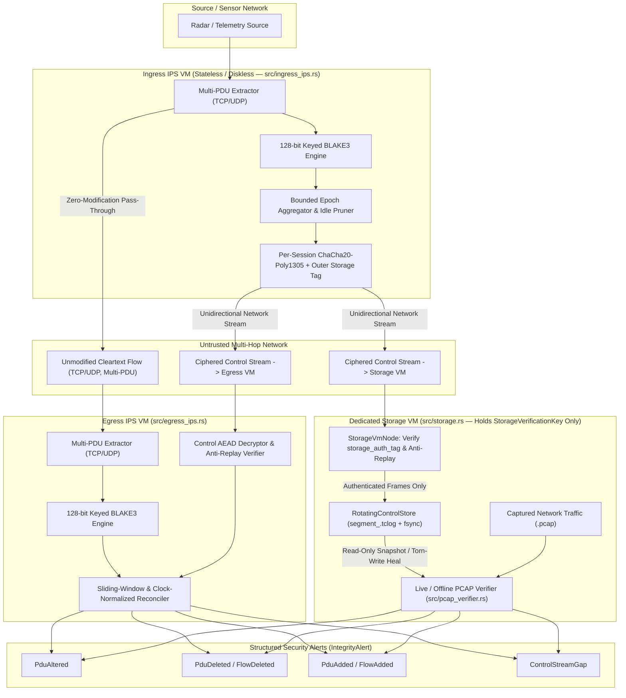

# AI-TrustChain — System Architecture & Detailed Design Document

**Version**: 1.0  
**Date**: 2026-11-09  
**Crate**: `ai-trustchain`  
**Language / Edition**: Rust 2021 (`#![forbid(unsafe_code)]`)

---

## 1. Executive Summary & Problem Statement

In multi-hop tactical, radar, or industrial networks protected by multiple Intrusion Prevention Systems (**IPS**), legitimate data flows must traverse untrusted intermediate network segments **without being ciphered or modified inline** (to preserve legacy receiver compatibility, zero inline latency, and MTU budgets).

**AI-TrustChain** solves this by pairing a **stateless, diskless Ingress IPS VM** ([`IngressIps`](file:///Users/jean-baptiste/AI-TrustChain/src/ingress_ips.rs)) with an **Egress IPS VM** ([`EgressIps`](file:///Users/jean-baptiste/AI-TrustChain/src/egress_ips.rs)) and a **dedicated Storage VM** ([`StorageVmNode`](file:///Users/jean-baptiste/AI-TrustChain/src/storage.rs)) that receives the ciphered Control Stream over the network and maintains a power-failure-safe rotating disk store ([`RotatingControlStore`](file:///Users/jean-baptiste/AI-TrustChain/src/storage.rs)) for live and offline `.pcap` forensic verification ([`pcap_verifier`](file:///Users/jean-baptiste/AI-TrustChain/src/pcap_verifier.rs)).

### Core Capabilities
1. **Selective Critical-Field Authentication**: Extracts `[X, Y, I, Timestamp]` from one or more Protocol Data Units (**PDUs**) per IP packet (`TCP` or `UDP`), ignoring non-critical ancillary/padding bytes that intermediate equipment may legitimately modify.
2. **UDP Loss & TCP Re-Segmentation Immunity**: Operates at the canonical PDU granularity using 128-bit keyed `BLAKE3` digests rather than packet-to-packet linear hash chains, so dropped UDP packets or coalesced TCP segments never trigger cascading false alarms.
3. **Full Anomaly Classification**: Distinguishes in-place coordinate modification (`PduAltered`), dropped packets (`PduDeleted`), spoofed/replayed packets (`PduAdded`), completely blackholed flows (`FlowDeleted`), unauthorized rogue flows (`FlowAdded`), and control channel tampering/loss (`ControlStreamGap`).
4. **Receiver-Agnostic & Decoupled Multi-VM Operation**:
   - The **Ingress IPS VM** performs zero disk I/O and streams `EncryptedControlFrame` packets unidirectionally (fire-and-forget) to both the **Egress IPS VM** and the **Storage VM**.
   - The **Storage VM** holds only a restricted [`StorageVerificationKey`](file:///Users/jean-baptiste/AI-TrustChain/src/crypto.rs#L74-L78) to verify an outer 128-bit authentication tag (`storage_auth_tag`) and enforce anti-replay monotonicity before persisting frames to disk—preventing attackers from filling or rotating the Storage VM's disk with garbage while keeping the `ControlPayload` encrypted and opaque to the Storage VM.

---

## 2. System Architecture (Multi-VM Topology)



---

## 3. Cryptographic & Wire Protocol Design ([`src/crypto.rs`](file:///Users/jean-baptiste/AI-TrustChain/src/crypto.rs), [`src/model.rs`](file:///Users/jean-baptiste/AI-TrustChain/src/model.rs))

### 3.1 Three-Way Domain-Separated Key Hierarchy & Least-Privilege Storage VM
From a shared 256-bit `master_secret: [u8; 32]`, [`TrustChainKeys::from_master_secret`](file:///Users/jean-baptiste/AI-TrustChain/src/crypto.rs#L90-L103) derives **three** cryptographically independent subkeys via `blake3::derive_key`:
1. `pdu_mac`: `"AI-TrustChain v1 PDU MAC Key"` (provisioned to Ingress IPS VM, Egress IPS VM, and PCAP Auditor).
2. `control_aead`: `"AI-TrustChain v1 Control Stream AEAD Key"` (provisioned to Ingress IPS VM, Egress IPS VM, and PCAP Auditor).
3. `storage_verify`: `"AI-TrustChain v1 Storage VM Verification Key"` (exported via [`TrustChainKeys::storage_verification_key`](file:///Users/jean-baptiste/AI-TrustChain/src/crypto.rs#L107-L111) into a restricted [`StorageVerificationKey`](file:///Users/jean-baptiste/AI-TrustChain/src/crypto.rs#L74-L78) provisioned to the **dedicated Storage VM**).

> [!IMPORTANT]
> **Least-Privilege Security on the Dedicated Storage VM**:
> Because the Storage VM only possesses `StorageVerificationKey`, it can cryptographically verify `EncryptedControlFrame::storage_auth_tag` at line rate before writing to disk (blocking any network attacker from filling or prematurely rotating the disk), **but even if the Storage VM is compromised**, the attacker cannot decrypt `ControlPayload` or forge `pdu_mac` / `control_aead` tags!

To prevent **AEAD nonce reuse across Ingress power cycles** (Weakness `DW-01`), every `IngressIps` boot generates a fresh 32-bit `boot_session_id` and derives a per-session `ChaCha20-Poly1305` key:
$$\text{SessionKey} = \text{BLAKE3\_Keyed}\left(K_{\text{control\_aead}}, \text{"AI-TrustChain v1 Session AEAD Subkey"} \parallel \text{sender\_id} \parallel \text{boot\_session\_id}\right)$$

`TrustChainKeys` implements `ZeroizeOnDrop` to scrub key material from RAM when dropped and redacts all key fields in `fmt::Debug`.

### 3.2 Canonical Floating-Point & 128-bit Per-PDU MAC
To ensure identical MAC computation across heterogeneous CPU architectures, [`canonicalize_f64`](file:///Users/jean-baptiste/AI-TrustChain/src/crypto.rs#L82-L90) normalizes `-0.0` to `+0.0` (`0x0000_0000_0000_0000`) and all IEEE-754 `NaN` bit patterns to a single canonical quiet `NaN` (`0x7ff8_0000_0000_0000`).

For each PDU in a flow, [`compute_pdu_xyi_mac`](file:///Users/jean-baptiste/AI-TrustChain/src/crypto.rs#L127-L139) computes a **128-bit (`u128`)** keyed `BLAKE3` digest (`DW-10`):
$$\text{xyi\_mac} = \text{Trunc}_{128}\Big(\text{BLAKE3\_Keyed}\big(K_{\text{pdu\_mac}}, \text{FiveTuple} \parallel T_{\text{us}} \parallel \text{Canon}(X) \parallel \text{Canon}(Y) \parallel \text{Canon}(I)\big)\Big)$$

### 3.3 Control Frame Structure & Hash Chaining
Each [`EncryptedControlFrame`](file:///Users/jean-baptiste/AI-TrustChain/src/model.rs#L172-L181) encapsulates an AEAD-encrypted [`ControlPayload`](file:///Users/jean-baptiste/AI-TrustChain/src/model.rs#L153-L164):
- **96-bit Nonce**: `boot_session_id (4B BE) || frame_seq (8B BE)`
- **18-byte AAD**: `Magic "TC" (0x5443) || sender_id (4B BE) || boot_session_id (4B BE) || frame_seq (8B BE)`
- **Chaining**: `ControlPayload.prev_chain_hash` holds the 256-bit `BLAKE3` digest of the preceding serialized `ControlPayload`, guaranteeing detection of dropped or suppressed control frames (`IntegrityAlert::ControlStreamGap`).

---

## 4. Sliding-Window Reconciliation & State Machine ([`src/egress_ips.rs`](file:///Users/jean-baptiste/AI-TrustChain/src/egress_ips.rs))

```mermaid
stateDiagram-v2
    [*] --> Unsynced: EgressIps::new()
    Unsynced --> Synced: First valid AEAD ControlFrame (any frame_seq)
    Synced --> Synced: Next ControlFrame (frame_seq == expected && prev_chain_hash matches)
    Synced --> GapAlert: ControlFrame gap (frame_seq > expected)
    GapAlert --> Synced: Re-anchor expected_frame_seq = frame_seq + 1
    Synced --> RejectedReplay: ControlFrame with frame_seq < expected (CryptoError::ControlFrameReplay)
    Synced --> Unsynced: reset_sync_state()
```

### 4.1 Disambiguating `PduAltered`, `PduDeleted`, and `PduAdded`
1. **Exact Match (Fast Path)**:
   - When a data PDU arrives at Egress (or when a delayed Control Frame arrives within `control_skew_tolerance_us`), Egress matches `(timestamp_us, xyi_mac)` against `pending_ingress`. Matching entries are immediately verified and removed.
2. **Dynamic Sensor-to-IPS Clock Calibration (`DW-11`)**:
   - Sensors may have clocks that lag or lead the IPS wall clock. Egress learns `sensor_to_ips_clock_offset_us = emitted_at_us - entry.timestamp_us` from authenticated control frames and normalizes PDU timestamps via [`normalize_to_ips_clock`](file:///Users/jean-baptiste/AI-TrustChain/src/egress_ips.rs#L321-L327) before comparing against `current_time_us`.
3. **Future-Timestamp Bypass Protection (`DW-04`)**:
   - [`is_past_skew_or_forged_future`](file:///Users/jean-baptiste/AI-TrustChain/src/egress_ips.rs#L333-L343) checks whether a PDU timestamp is either older than `current_time_us - skew_tol` **or** implausibly far in the future (`ts > current_time_us + skew_tol`), preventing attackers from setting `timestamp_us = u64::MAX` to hide in `pending_egress`.
4. **Two-Tier `PduAltered` vs. `PduAdded` Correlation (`DW-05`)**:
   - Once `control_skew_tolerance_us` elapses for an unmatched Egress PDU:
     - **Tier 1**: Searches `pending_ingress` for an unmatched slot with the exact same `timestamp_us`.
     - **Tier 2**: Falls back to the closest unmatched slot within `control_skew_tolerance_us` (catching attackers who alter `[X, Y, I]` and also nudge `timestamp_us`).
     - If a slot is found, it is consumed and **`PduAltered`** is emitted; otherwise, **`PduAdded`** is emitted.
5. **Grace Window Expiration (`PduDeleted` & `FlowDeleted`)**:
   - If a flow declared active since Egress synchronized receives 0 data packets after `grace_window_us`, **`FlowDeleted`** is emitted.
   - Any individual `pending_ingress` slot remaining unmatched after `grace_window_us` emits **`PduDeleted`**.

---

## 5. Power-Failure-Safe Rotating Store & Live PCAP Verification ([`src/storage.rs`](file:///Users/jean-baptiste/AI-TrustChain/src/storage.rs), [`src/pcap_verifier.rs`](file:///Users/jean-baptiste/AI-TrustChain/src/pcap_verifier.rs))

### 5.1 On-Disk Segment Format (`segment_<020_seq>.tclog`)
```
+-------------------------------------------------------------------+
| Segment File Header (8 bytes): "TCLOGV01"                         |
+-------------------------------------------------------------------+
| Record 0:                                                         |
|   - payload_len: u32 (4 bytes BE)                                 |
|   - checksum: [u8; 16] (128-bit BLAKE3 over payload_len || bytes) |
|   - payload_bytes: [u8; payload_len] (EncryptedControlFrame)      |
+-------------------------------------------------------------------+
| Record 1 ... Record N                                             |
+-------------------------------------------------------------------+
```

### 5.2 Crash / Power-Failure Recovery & Rotation Guarantees
- **Commit Durability**: Every [`append_frame`](file:///Users/jean-baptiste/AI-TrustChain/src/storage.rs#L142-L179) writes the complete 20-byte header + payload and invokes `File::sync_data()` (`fsync`). If `write_all` or `sync_data` fails (e.g., disk full `ENOSPC`), `append_frame` immediately truncates and seeks back to `self.active_file_len` (`DW-08`).
- **Torn-Write Healing**: On startup (`RotatingControlStore::open`) or offline verification (`read_all_frames`), `read_and_heal_segment` verifies the 128-bit `BLAKE3` checksum of every record. If a power loss left a truncated record or corrupted tail at the end of a segment, the file is truncated (`set_len`) back to the last valid record offset and `sync_all()`-ed.
- **Ring Rotation**: When `active_file_len + record_len > max_segment_bytes`, the store rotates to `segment_<seq+1>.tclog`, unlinks the oldest segment(s) exceeding `max_segments`, and `fsync`s the parent directory.

### 5.3 Live Concurrent PCAP Verification During Active Rotation
When verifying a `.pcap` capture while `IngressIps` and `RotatingControlStore` are actively running in the background:
1. [`RotatingControlStore::read_all_frames_live`](file:///Users/jean-baptiste/AI-TrustChain/src/storage.rs#L220-L245) opens segment files strictly in **read-only** mode (`File::open`), never calls `set_len`, ignores segments concurrently unlinked by rotation (`ErrorKind::NotFound`), and stops cleanly at any in-flight partial tail write.
2. [`verify_packets_with_frames`](file:///Users/jean-baptiste/AI-TrustChain/src/pcap_verifier.rs#L417-L485) preserves all packets from unknown flows (so `FlowAdded` is never clipped, `DW-03`) and only clips early timestamps on known flows if segment rotation actually evicted earlier frames (`first_frame.frame_seq > 0`).
3. [`parse_ethernet_ipv4_frame`](file:///Users/jean-baptiste/AI-TrustChain/src/pcap_verifier.rs#L287-L361) parses standard Libpcap (little- and big-endian) Ethernet II + IPv4 + TCP/UDP headers, bounding packets strictly by IPv4 `Total Length` (`DW-09`) to strip 64-byte minimum Ethernet L2 trailer padding.

### 5.4 Estimated Disk Occupancy & Sizing Formulas

Because [`RotatingControlStore`](file:///Users/jean-baptiste/AI-TrustChain/src/storage.rs) enforces a hard ring-buffer ceiling via [`StorageConfig`](file:///Users/jean-baptiste/AI-TrustChain/src/storage.rs#L46-L62), **total disk occupancy is strictly bounded** and can be sized deterministically for any mission retention window.

#### 1. Exact Per-Record Byte Breakdown (`bincode` + AEAD + `.tclog` Framing)
Every persisted Control Stream epoch (`EncryptedControlFrame`) on disk consists of:

| Layer | Field / Component | Size (Bytes) |
| :--- | :--- | :--- |
| **Segment File Header** | `"TCLOGV01"` magic (once per `.tclog` segment file) | $8\text{ B}$ |
| **Record Outer Header** | `payload_len: u32` ($4\text{ B}$) + `checksum: [u8; 16]` ($16\text{ B}$) | $20\text{ B}$ |
| **Encrypted Frame Header & Tag** | `sender_id: u32` ($4\text{ B}$) + `boot_session_id: u32` ($4\text{ B}$) + `frame_seq: u64` ($8\text{ B}$) + `ciphertext_len: u64` ($8\text{ B}$) + `storage_auth_tag: u128` ($16\text{ B}$) | $40\text{ B}$ |
| **AEAD Authentication Tag** | `ChaCha20-Poly1305` MAC tag | $16\text{ B}$ |
| **ControlPayload Header** | `boot_session_id: u32` ($4\text{ B}$) + `frame_seq: u64` ($8\text{ B}$) + `prev_chain_hash: [u8; 32]` ($32\text{ B}$) + `emitted_at_us: u64` ($8\text{ B}$) + `flows_len: u64` ($8\text{ B}$) | $60\text{ B}$ |
| **Per Active Flow (`FlowEpochSummary`)** | `FiveTuple` IPv4 ($20\text{ B}$ / IPv6 $44\text{ B}$) + `cumulative_pdu_count: u64` ($8\text{ B}$) + `epoch_pdu_count: u64` ($8\text{ B}$) + `entries_len: u64` ($8\text{ B}$) | $44\text{ B}$ (IPv4) |
| **Per PDU (`PduControlEntry`)** | `pdu_seq: u64` ($8\text{ B}$) + `timestamp_us: u64` ($8\text{ B}$) + `xyi_mac: u128` ($16\text{ B}$) | **$32\text{ B}$** |

#### 2. Closed-Form Disk Write-Rate Formula on the Storage VM
For an epoch emission rate of $f_{\text{epoch}}$ (frames/sec), $F$ active IPv4 flows, and $R_{\text{pdu}}$ total PDUs/sec across all flows:

$$\text{Bytes per Epoch} = 136 + 44 \cdot F + 32 \cdot \left(\frac{R_{\text{pdu}}}{f_{\text{epoch}}}\right)$$

$$\text{Disk Write Rate (Bytes/sec)} = (136 + 44 \cdot F) \cdot f_{\text{epoch}} + 32 \cdot R_{\text{pdu}}$$

#### 3. Representative Operational Profiles (on the Dedicated Storage VM)

| Scenario | Epoch Rate ($f_{\text{epoch}}$) | Active Flows ($F$) | Total PDU Rate ($R_{\text{pdu}}$) | Disk Write Rate | Time Retained in Default Store ($3.75\text{ GiB}$) | Disk Needed for $1\text{ Hour}$ Retention | Disk Needed for $24\text{ Hours}$ Retention |
| :--- | :--- | :--- | :--- | :--- | :--- | :--- | :--- |
| **Low-Rate Radar / Telemetry** (e.g., 1 radar, 100 tracks/s) | $10\text{ Hz}$ ($100\text{ ms}$) | $4$ | $100\text{ PDUs/s}$ | **$6.32\text{ KB/s}$** | $\approx 7.3\text{ days}$ | **$22.2\text{ MB}$** | **$533\text{ MB}$** |
| **Medium Multi-Sensor Network (Default Target)** (e.g., 10 flows, 1,000 PDUs/s) | $20\text{ Hz}$ ($50\text{ ms}$) | $10$ | $1,000\text{ PDUs/s}$ | **$43.5\text{ KB/s}$** | **$\approx 25.7\text{ hours}$ ($> 1\text{ day}$)** | **$149.4\text{ MB}$** | **$3.50\text{ GiB}$ ($3.76\text{ GB}$)** |
| **High-Rate Tactical / EW Burst** (e.g., 50 flows, 10,000 PDUs/s) | $20\text{ Hz}$ ($50\text{ ms}$) | $50$ | $10,000\text{ PDUs/s}$ | **$366.7\text{ KB/s}$** | $\approx 3.0\text{ hours}$ | **$1.26\text{ GiB}$** | **$30.2\text{ GiB}$** |
| **Extreme Backbone Load** (e.g., 200 flows, 100,000 PDUs/s) | $50\text{ Hz}$ ($20\text{ ms}$) | $200$ | $100,000\text{ PDUs/s}$ | **$3.65\text{ MB/s}$** | $\approx 18.4\text{ min}$ | **$12.5\text{ GiB}$** | **$300.5\text{ GiB}$** |

#### 4. Maximum Disk Footprint Guarantee
Regardless of traffic spikes or mission duration, total disk occupancy on the local filesystem never exceeds:
$$\text{Max Disk Occupancy} = \text{max\_segments} \times \text{max\_segment\_bytes}$$
- **Default Configuration (`StorageConfig::default()`)**: $60\text{ segments} \times 64\text{ MiB} = \mathbf{3,840\text{ MiB}}$ ($\mathbf{3.75\text{ GiB}} \approx \mathbf{4.03\text{ GB}}$) maximum on disk, sustaining **$> 24\text{ hours}$ ($1\text{ full day}$) of continuous traffic at $1,000\text{ PDUs/s}$**.

---

## 6. Zero-False-Positive Guarantee Matrix (Remote Egress & Local Storage PCAP)

The protocol is explicitly engineered so that **no benign network, OS, clock, or lifecycle condition can trigger a false-positive `IntegrityAlert`** on either the remote [`EgressIps`](file:///Users/jean-baptiste/AI-TrustChain/src/egress_ips.rs) or the local [`pcap_verifier`](file:///Users/jean-baptiste/AI-TrustChain/src/pcap_verifier.rs) on the Storage VM:

| # | Benign Operational Scenario | Why Naive Designs Emit False Positives | AI-TrustChain Zero-False-Positive Mechanism |
| :--- | :--- | :--- | :--- |
| **1** | **Non-critical payload bytes modified in transit** (e.g., routing telemetry, QoS tags, checksums, padding) | Packet-level hashes fail whenever any byte outside `[X, Y, I, Timestamp]` changes. | [`compute_pdu_xyi_mac`](file:///Users/jean-baptiste/AI-TrustChain/src/crypto.rs#L172-L184) binds strictly to `(FiveTuple, Timestamp, Canon(X), Canon(Y), Canon(I))` and ignores `Pdu::non_critical`. |
| **2** | **Heterogeneous CPU floating-point representations** (`-0.0` vs `+0.0`, differing `NaN` payloads) | Bitwise IEEE-754 hashing produces different digests on different FPU pipelines. | [`canonicalize_f64`](file:///Users/jean-baptiste/AI-TrustChain/src/crypto.rs#L124-L132) normalizes `-0.0 -> +0.0` and all `NaN` bit patterns to canonical quiet `NaN` (`0x7ff8_0000_0000_0000`). |
| **3** | **Layer 4 Post-TCP-Stack Placement & TCP Stream Coalescing / Re-Segmentation** | We sit at **Layer 4 (after the OS TCP stack)**, so TCP retransmissions and out-of-order TCP segments are absorbed by the kernel TCP stack before reaching our extractor. However, the Layer 4 stream read can coalesce multiple PDUs into one buffer or split them across reads. | Extraction and `xyi_mac` computation operate at the **individual `Pdu` granularity** rather than packet/read boundaries, so 10 PDUs read in 1 chunk at Ingress and 2 chunks of 5 PDUs at Egress reconcile with 0 alerts. |
| **4** | **Data packet arrives at Egress *before* its Control Frame** (control path jitter) | Immediate lookup in `pending_ingress` misses and falsely raises `PduAdded` or `FlowAdded`. | Unmatched Egress PDUs wait in `pending_egress` for `control_skew_tolerance_us`. When the Control Frame arrives within the window, [`receive_control_frame`](file:///Users/jean-baptiste/AI-TrustChain/src/egress_ips.rs#L261-L267) reconciles and removes them immediately. |
| **5** | **Unsynchronized sensor clock vs. IPS wall clock** (including on brand-new flows arriving before their first Control Frame) | Comparing raw sensor `timestamp_us` against IPS `current_time_us` triggers premature `PduDeleted` or `FlowAdded` when sensor clocks lag. | [`EgressIps`](file:///Users/jean-baptiste/AI-TrustChain/src/egress_ips.rs#L128-L131) learns both per-flow `sensor_to_ips_clock_offset_us` and a fallback `global_clock_offset_us`, normalizing timestamps via [`normalize_to_ips_clock`](file:///Users/jean-baptiste/AI-TrustChain/src/egress_ips.rs#L350-L356) before any watermark comparison (`FlowAdded`, `PduAltered`, `PduDeleted`). |
| **6** | **Late join, reboot, or maintenance reconnect** of Egress IPS VM or Storage VM | Historical cumulative PDU counts or pre-join packets trigger false `FlowDeleted` / `PduDeleted`. | Egress anchors `baseline_cumulative_pdus` on its first observed frame (`expected_pdus_since_sync`), and `StorageVmNode` self-synchronizes on its first valid `storage_auth_tag`. |
| **7** | **Live `.pcap` verification during active segment rotation and in-flight epoch buffering** on the Storage VM | 1. Earlier segments rotated off disk lack control entries for old `.pcap` packets (`PduAdded`).<br>2. Brand-new `.pcap` packets at the tail of the capture haven't had their control epoch flushed yet (`PduAdded`).<br>3. Control frames at the end of the store cover packets after the `.pcap` capture stopped (`PduDeleted`). | [`verify_packets_with_frames`](file:///Users/jean-baptiste/AI-TrustChain/src/pcap_verifier.rs#L417-L495) applies a **two-sided window guard** (`[min_retained_ts_us, max_retained_ts_us]`):<br>- Clips pre-rotation `.pcap` packets on known flows (`ts < min_retained_ts_us` when `first_frame.frame_seq > 0`).<br>- Clips in-flight tail `.pcap` packets on known flows (`ts > max_retained_ts_us`) whose control frame has not yet been flushed.<br>- Evaluates final watermarks bounded by `max_observed_pcap_ts + control_skew_tolerance_us` so post-capture control entries never cause false `PduDeleted`. |
| **8** | **Ethernet L2 minimum-frame trailer padding** (`64-byte` minimum frame on wire) in `.pcap` captures | Reading to the end of the Ethernet frame instead of the IPv4 `Total Length` header corrupts `non_critical_len` or PDU framing. | [`parse_ethernet_ipv4_frame`](file:///Users/jean-baptiste/AI-TrustChain/src/pcap_verifier.rs#L287-L361) slices the packet strictly to `14 + ip_total_len` before L4/PDU parsing. |

---

## 7. Module Map & Verification Summary

| File | Description |
| :--- | :--- |
| [`src/lib.rs`](file:///Users/jean-baptiste/AI-TrustChain/src/lib.rs) | Crate root enforcing `#![forbid(unsafe_code)]` and `#![warn(missing_docs, clippy::all, clippy::pedantic)]`. |
| [`src/model.rs`](file:///Users/jean-baptiste/AI-TrustChain/src/model.rs) | Domain types: `FiveTuple`, `Protocol`, `Pdu`, `IpPacket`, `PduControlEntry`, `ControlPayload`, `EncryptedControlFrame`, `IntegrityAlert`. |
| [`src/crypto.rs`](file:///Users/jean-baptiste/AI-TrustChain/src/crypto.rs) | `TrustChainKeys` (`ZeroizeOnDrop`), `StorageVerificationKey`, `canonicalize_f64`, 128-bit `compute_pdu_xyi_mac`, `ChaCha20-Poly1305` per-session AEAD encryption/decryption. |
| [`src/ingress_ips.rs`](file:///Users/jean-baptiste/AI-TrustChain/src/ingress_ips.rs) | Stateless/diskless `IngressIps` & `IngressConfig`: cleartext multi-PDU observation, bounded ring buffers, idle flow pruning, and network control frame emission. |
| [`src/egress_ips.rs`](file:///Users/jean-baptiste/AI-TrustChain/src/egress_ips.rs) | `EgressIps` & `VerifierConfig`: self-synchronizing control chain, anti-replay, per-flow + global clock-offset normalization, and sliding-window anomaly detection. |
| [`src/storage.rs`](file:///Users/jean-baptiste/AI-TrustChain/src/storage.rs) | `StorageVmNode`, `RotatingControlStore` & `StorageConfig`: least-privilege `storage_auth_tag` verification, power-failure-safe segmented WAL with 128-bit checksums, torn-write healing, and live read-only snapshots. |
| [`src/pcap_verifier.rs`](file:///Users/jean-baptiste/AI-TrustChain/src/pcap_verifier.rs) | Libpcap `.pcap` reader/writer and `verify_pcap_against_store` / `verify_pcap_against_live_store` with two-sided window clipping for zero false positives. |
| [`tests/integration_tests.rs`](file:///Users/jean-baptiste/AI-TrustChain/tests/integration_tests.rs) | 10 end-to-end integration and multi-threaded stress tests covering all operational, crash-recovery, zero-false-positive, and adversarial scenarios. |

