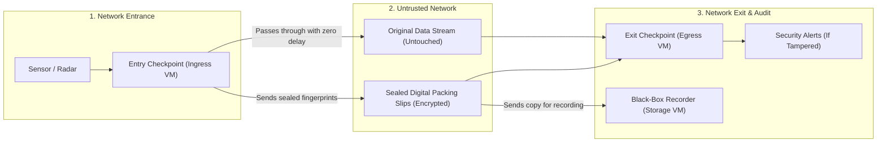

# AI-TrustChain — Executive & Non-Technical Overview

**Purpose of this document**: Explain what **AI-TrustChain** does, why it is needed, and how it guarantees data trustworthiness across untrusted networks—written in plain language without cryptographic or programming jargon.

---

## 1. The Core Problem: Protecting Live Data You Aren't Allowed to Touch

Imagine a radar station or sensor sending live position updates (`X`, `Y`, intensity `I`, and `Time`) across a large network to a command center. Between the sensor and the command center, the data travels through multiple routers, switches, and third-party network links that we do not fully control.

Normally, IT teams protect data by **encrypting** it (locking it inside a digital safe before sending it). **However, in many critical systems, we are not allowed to encrypt or modify the live data stream** because:
1. **Legacy Equipment**: Existing receivers and displays expect the data in its original format and would break if the format changed.
2. **Zero Delay Requirement**: Stopping every message to lock and unlock it adds delay that real-time systems cannot tolerate.
3. **Allowed Transit Updates**: Intermediate network equipment legitimately updates minor "housekeeping" notes attached to the messages (such as routing statistics or quality indicators) while the message is in transit.

### The Risk
If we cannot lock the data stream itself, how do we know that an attacker—or a faulty piece of equipment—in the middle of the network hasn't:
- **Changed** a coordinate (moving a radar track from point A to point B)?
- **Deleted** a message (hiding an object completely)?
- **Inserted** a fake message (creating a "ghost" object on the screen)?

---

## 2. The Solution: The "Armored Packing Slip" Analogy

**AI-TrustChain** solves this using the same principle a bank uses when shipping glass display items via a standard courier:

1. **The Main Shipment (Unmodified Data Flow)**: The original messages travel down the normal network path completely untouched. Legacy systems work without any changes, and there is zero added delay.
2. **The Armored Packing Slip (Encrypted Control Stream)**: At the entrance of the network, a security checkpoint silently observes the messages as they pass by. For each message, it writes down a tiny **digital fingerprint** of *only* the critical facts (`X`, `Y`, `I`, and `Time`)—ignoring the housekeeping notes that are allowed to change. Every few milliseconds, it seals these fingerprints inside an **encrypted, tamper-proof digital envelope** and sends it over a separate control channel.

---

## 3. The Three Building Blocks (And Why They Are Separated)

To keep the system simple, fast, and resilient, **AI-TrustChain** splits the job across three independent virtual machines (VMs):

### 1. The Entry Checkpoint (`Ingress VM`)
- **What it does**: Watches data enter the network, calculates a tiny digital fingerprint for each message's critical values (`X`, `Y`, `I`, `Time`), and mails out the sealed packing slips.
- **No Hard Drive Needed**: It stores nothing on disk. If the power blinks, it restarts instantly and picks right back up.

### 2. The Exit Checkpoint (`Egress VM`)
- **What it does**: Sits at the receiving end before the command center. It compares the arriving data messages against the sealed packing slips from the Entry Checkpoint.
- **What it catches**: Within a fraction of a second, it tells you not just *that* something went wrong, but **exactly what happened**:
  - **Message Altered**: *"Message #42 arrived, but its `X` coordinate was changed in transit."*
  - **Message Deleted**: *"Message #43 was listed on the packing slip, but never arrived."*
  - **Fake Message Added**: *"A message arrived that was never on any packing slip from the Entry Checkpoint."*
  - **Entire Stream Cut**: *"The sensor is still sending data according to the packing slips, but the entire stream was blocked in transit."*
  - **Unauthorized Stream Added**: *"A brand-new data stream appeared in the network that never passed through the Entry Checkpoint."*

### 3. The Separate "Black-Box Recorder" (`Storage VM`)
- **What it does**: Just like an airplane's black-box flight recorder, this separate machine continuously records the sealed packing slips onto its hard drive in a circular loop (automatically overwriting the oldest files once the allotted disk space is full).
- **Why it is on a separate machine**: Keeping storage off the Entry and Exit Checkpoints means those checkpoints never slow down or wear out disks.
- **How it is used**: Security teams can take any raw network recording (a `.pcap` file) and compare it against the Black-Box Recorder—even **live while the system is running**—to prove whether historical traffic was genuine or tampered with.
- **Built-in Compartmentalization ("Least Privilege")**: The Black-Box Recorder is given a special "verify-only" badge. It can verify that incoming packing slips genuinely came from the Entry Checkpoint (so an attacker cannot fill its hard drive with junk), **but it cannot open and read the packing slips itself**. Even if someone broke into the Black-Box Recorder VM, they could not forge data or read sensitive mission details.

---

## 4. Why This Design Never Raises False Alarms ("Zero False Positives")

A security system that cries wolf during normal network hiccups is unusable in real operations. **AI-TrustChain** is specifically designed so that everyday network behaviors **never** trigger false alarms:

| Everyday Situation | What Usually Goes Wrong in Simple Systems | How AI-TrustChain Prevents False Alarms |
| :--- | :--- | :--- |
| **Routers update housekeeping data in transit** | A standard check sees that *something* in the message changed and raises a false alarm. | The fingerprint only covers the critical fields (`X`, `Y`, `I`, `Time`) and ignores the non-critical housekeeping area. |
| **Network repackages messages into bigger or smaller bundles** | Checking whole network packets fails when the operating system combines two small messages or splits a large one. | Fingerprints are attached to **individual messages**, not the outer shipping box. Whether 10 messages arrive in 1 box or 2 boxes of 5, they verify cleanly. |
| **A data message arrives slightly *before* its packing slip** | The Exit Checkpoint hasn't seen the packing slip yet and falsely thinks the message is fake. | The Exit Checkpoint holds early-arriving messages in a brief waiting room (e.g., 50 milliseconds) so the packing slip can catch up. |
| **One message is lost in transit (normal on wireless/UDP links)** | In chain-based systems, losing one message breaks the chain for every message that follows. | Each message has its own independent fingerprint on the packing slip. If message #5 is dropped, *only* message #5 is reported missing; messages #6, #7, and #8 still verify normally. |
| **The sensor's clock is out of sync with the Checkpoint's clock** | The Checkpoint thinks a message with an old sensor timestamp was delayed for hours and marks it lost. | The Exit Checkpoint automatically learns the time difference between the sensor's clock and its own clock and adjusts for it. |
| **A Checkpoint reboots or is turned on mid-mission** | The Checkpoint thinks it missed thousands of earlier messages and floods the screen with alerts. | Checkpoints automatically synchronize from the moment they wake up, judging only the traffic that flows after they come online. |
| **Sudden power outage on the Black-Box Recorder** | Half-written files on the hard drive corrupt the database when power returns. | Every record is sealed with a validity check. On restart, the recorder automatically trims any half-written tail from a power cut and resumes cleanly. |

---

## 5. How Much Disk Space Does the Black-Box Recorder Need?

Because the Black-Box Recorder only stores **compact digital fingerprints** (32 bytes—about the length of a short sentence—per message) rather than the full data stream, its storage footprint is very small and **strictly capped**. Once it reaches its configured limit, it automatically recycles the oldest file, so the disk can never fill up and crash.

| Type of Operation | Messages per Second | Storage Space Needed for **1 Hour** of History | Storage Space Needed for **24 Hours** of History |
| :--- | :--- | :--- | :--- |
| **Small Sensor / Single Radar** | $100\text{ messages/sec}$ | **$\approx 22\text{ MB}$** *(size of 5 photos)* | **$\approx 533\text{ MB}$** |
| **Medium Multi-Sensor Site (Default Target)** | $1,000\text{ messages/sec}$ | **$\approx 150\text{ MB}$** | **$\approx 3.76\text{ GB}$** *(fits on a small USB drive)* |
| **High-Speed Tactical Burst** | $10,000\text{ messages/sec}$ | **$\approx 1.3\text{ GB}$** | **$\approx 30\text{ GB}$** |
| **Large Backbone Network** | $100,000\text{ messages/sec}$ | **$\approx 12.5\text{ GB}$** | **$\approx 300\text{ GB}$** |

*(By default, the recorder is configured with a **$4\text{ GB}$ ($3.75\text{ GiB}$)** circular buffer—$60$ files of $64\text{ MiB}$ each—which automatically retains **more than 24 hours (1 full day)** of continuous traffic at $1,000\text{ messages/sec}$.)*

---

## 6. Bottom-Line Summary for Decision Makers

1. **Zero Impact on Operations**: The original data stream is never encrypted, delayed, or altered.
2. **Complete Visibility**: Immediately distinguishes between modified data, dropped data, and injected fake data.
3. **Resilient by Design**: Survives packet loss, power outages, clock drift, and equipment reboots without false alarms.
4. **Live & Historical Auditing**: A separate, tamper-resistant Black-Box Recorder allows operators to audit network captures (`.pcap` files) against the ground-truth fingerprints at any time—even while the system is running live.

