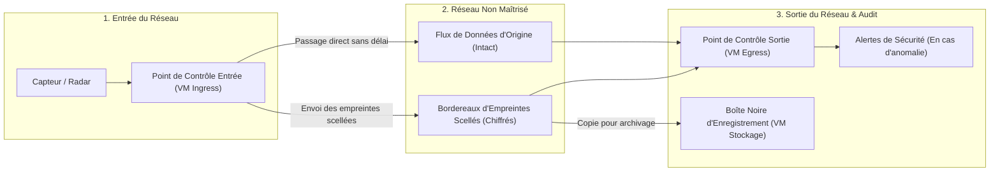

# AI-TrustChain — Synthèse Exécutive et Présentation Non Technique

**Objectif de ce document** : Expliquer ce que fait **AI-TrustChain**, pourquoi ce système est nécessaire et comment il garantit l'intégrité des données à travers des réseaux non maîtrisés — en langage clair, sans jargon cryptographique ni informatique.

---

## 1. Le Problème : Protéger des Données en Temps Réel qu'il est Interdit de Modifier

Imaginez une station radar ou un capteur envoyant en continu des positions (`X`, `Y`, intensité `I` et `Heure`) vers un centre de commandement à travers un vaste réseau. Entre le capteur et le centre de commandement, les données traversent de nombreux routeurs, commutateurs et liaisons réseau tiers que nous ne contrôlons pas entièrement.

Habituellement, les équipes informatiques protègent les données en les **chiffrant** (c'est-à-dire en les enfermant dans un coffre-fort numérique avant de les envoyer). **Or, dans de nombreux systèmes opérationnels critiques, il est interdit de chiffrer ou de modifier le flux de données d'origine** pour trois raisons :
1. **Compatibilité avec les équipements existants** : Les récepteurs et écrans de contrôle existants attendent les données dans leur format d'origine et cesseraient de fonctionner si ce format était modifié.
2. **Exigence de latence nulle (Temps Réel)** : Arrêter chaque message pour le verrouiller puis le déverrouiller introduit un retard incompatible avec les opérations temps réel.
3. **Modifications légitimes en cours de route** : Les équipements réseau intermédiaires mettent légitimement à jour certaines informations secondaires (« notes de service » comme des indicateurs de routage ou de qualité) pendant que le message circule.

### Le Risque Opérationnel
Si nous ne pouvons pas verrouiller le flux de données lui-même, comment être certain qu'un attaquant — ou un équipement défaillant — situé au milieu du réseau n'a pas :
- **Modifié** une coordonnée (déplaçant une piste radar du point A vers le point B) ?
- **Supprimé** un message (faisant disparaître un objet de l'écran) ?
- **Injecté** un faux message (créant un objet « fantôme » sur l'écran) ?

---

## 2. La Solution : L'Analogie du « Bordereau d'Expédition Blindé »

**AI-TrustChain** résout ce problème en appliquant le même principe qu'un transporteur de valeurs qui expédie des objets fragiles :

1. **L'Envoi Principal (Flux de Données Intact)** : Les messages d'origine circulent sur le réseau normal sans aucune modification. Les équipements existants fonctionnent sans changement et sans aucun délai supplémentaire.
2. **Le Bordereau d'Expédition Blindé (Flux de Contrôle Chiffré)** : À l'entrée du réseau, un point de contrôle observe silencieusement les messages au passage. Pour chaque message, il relève une minuscule **empreinte numérique** portant *uniquement* sur les données critiques (`X`, `Y`, `I` et `Heure`) — en ignorant les notes secondaires autorisées à évoluer. Toutes les quelques millisecondes, il place ces empreintes dans une **enveloppe numérique chiffrée et infalsifiable** qu'il envoie sur un canal de contrôle séparé.

---

## 3. Les Trois Briques du Système (et Pourquoi Elles Sont Séparées)

Pour rester simple, rapide et résilient, **AI-TrustChain** répartit le travail sur trois machines virtuelles (VM) indépendantes :

### 1. Le Point de Contrôle d'Entrée (`VM Ingress`)
- **Son rôle** : Observer les données qui entrent dans le réseau, calculer l'empreinte numérique des valeurs critiques (`X`, `Y`, `I`, `Heure`) de chaque message, et expédier les bordereaux scellés.
- **Aucun disque dur requis** : Elle ne stocke rien sur disque. En cas de micro-coupure électrique, elle redémarre instantanément et reprend son travail immédiatement.

### 2. Le Point de Contrôle de Sortie (`VM Egress`)
- **Son rôle** : Situé à l'arrivée avant le centre de commandement, il compare les messages reçus avec les bordereaux scellés envoyés par l'Entrée.
- **Ce qu'il détecte** : En une fraction de seconde, il indique non seulement *qu'un problème est survenu*, mais **exactement de quelle nature** :
  - **Message Altéré (`PduAltered`)** : *« Le message n°42 est bien arrivé, mais sa coordonnée `X` a été modifiée en chemin. »*
  - **Message Supprimé (`PduDeleted`)** : *« Le message n°43 figurait sur le bordereau d'expédition, mais n'est jamais arrivé. »*
  - **Faux Message Injecté (`PduAdded`)** : *« Un message est arrivé alors qu'il ne figure sur aucun bordereau du Point d'Entrée. »*
  - **Flux Entier Coupé (`FlowDeleted`)** : *« Les bordereaux indiquent que le capteur émet toujours, mais l'intégralité du flux a été bloquée en chemin. »*
  - **Flux Pirate Ajouté (`FlowAdded`)** : *« Un nouveau flux de données inconnu est apparu sur le réseau sans jamais être passé par le Point d'Entrée. »*

### 3. La « Boîte Noire » d'Enregistrement Dédiée (`VM Stockage`)
- **Son rôle** : Exactement comme la boîte noire d'un avion, cette machine dédiée enregistre en continu les bordereaux scellés sur son disque dur sous forme de boucle rotative (en écrasant automatiquement les fichiers les plus anciens lorsque l'espace alloué est plein).
- **Pourquoi une machine séparée** : Déporter le stockage sur une machine dédiée garantit que les Points de Contrôle d'Entrée et de Sortie ne sont jamais ralentis par des écritures sur disque.
- **Comment elle est utilisée** : Les équipes de sécurité peuvent prendre n'importe quel enregistrement brut du trafic réseau (un fichier `.pcap`) et le comparer à la Boîte Noire — **y compris en direct pendant que le système tourne** — pour prouver mathématiquement si le trafic réseau a été altéré ou non.
- **Cloisonnement de sécurité (« Moindre Privilège »)** : La Boîte Noire ne détient qu'un « badge de vérification ». Elle peut vérifier que chaque bordereau provient bien du Point d'Entrée (empêchant un attaquant de saturer son disque avec de fausses données), **mais elle ne peut ni ouvrir ni lire le contenu des bordereaux**. Même si un attaquant compromettait la VM de Stockage, il ne pourrait ni lire les données de mission, ni fabriquer de faux bordereaux.

---

## 4. Pourquoi Ce Système Ne Génère Aucune Fausse Alerte (« Zéro Faux Positif »)

Un système de sécurité qui déclenche de fausses alertes au moindre aléa réseau est inutilisable en opération. **AI-TrustChain** est conçu pour que les comportements normaux du réseau ne déclenchent **jamais** de fausse alerte :

| Situation Opérationnelle Normale | Pourquoi les systèmes classiques déclenchent de fausses alertes | Comment AI-TrustChain garantit Zéro Fausse Alerte |
| :--- | :--- | :--- |
| **Les routeurs mettent à jour des données secondaires en transit** | Un contrôle global voit qu'un octet a changé dans le paquet et déclenche une fausse alerte. | L'empreinte ne porte que sur les champs critiques (`X`, `Y`, `I`, `Heure`) et ignore la zone secondaire non critique. |
| **Le système regroupe ou découpe les messages (flux TCP)** | Nous nous situons après la pile TCP du système d'exploitation (les retransmissions TCP sont donc déjà absorbées), mais plusieurs messages peuvent être regroupés en une seule lecture. | Les empreintes sont attachées à **chaque message individuel**, et non au paquet réseau. Que 10 messages arrivent en 1 seul bloc ou en 2 blocs de 5, la vérification réussit sans alerte. |
| **Un message de données arrive légèrement *avant* son bordereau** | Le Point de Sortie n'a pas encore reçu le bordereau et croit à tort qu'il s'agit d'un faux message. | Le Point de Sortie place le message en salle d'attente pendant quelques dizaines de millisecondes (ex. 50 ms) le temps que le bordereau arrive. |
| **Un message est perdu sur une liaison radio/UDP** | Dans les systèmes en chaîne, la perte d'un seul message casse toute la chaîne pour les messages suivants. | Chaque message possède sa propre empreinte indépendante. Si le message n°5 est perdu, *seul* le message n°5 est signalé manquant ; les messages n°6, n°7 et n°8 sont validés normalement. |
| **L'horloge du capteur est décalée par rapport à celle du Point de Contrôle** | Le Point de Contrôle croit que le message a plusieurs heures de retard et le déclare perdu. | Le Point de Sortie calcule automatiquement l'écart d'horloge avec le capteur et corrige les horodatages en conséquence. |
| **Un Point de Contrôle redémarre ou rejoint le réseau en cours de mission** | Le Point de Contrôle croit avoir manqué tous les messages précédents et inonde l'opérateur d'alertes. | Les Points de Contrôle se synchronisent automatiquement dès leur mise en route et ne jugent que le trafic qui circule à partir de cet instant. |
| **Coupure brutale de courant sur la Boîte Noire** | Un fichier écrit à moitié lors de la coupure corrompt la base de données au redémarrage. | Chaque enregistrement est protégé par un sceau d'intégrité. Au retour du courant, la Boîte Noire nettoie automatiquement la fin de fichier incomplète et reprend sans erreur. |

---

## 5. Quel Espace Disque Faut-il sur la Boîte Noire ?

Comme la Boîte Noire n'enregistre que des **empreintes numériques compactes** (32 octets — soit la taille d'une courte phrase — par message) au lieu d'enregistrer tout le flux de données, l'espace disque nécessaire est très faible et **strictement plafonné**. Dès que la limite est atteinte, le fichier le plus ancien est recyclé automatiquement : le disque ne peut jamais saturer.

| Profil Opérationnel | Cadence de Messages | Espace Disque pour **1 Heure** d'Historique | Espace Disque pour **24 Heures (1 Jour)** d'Historique |
| :--- | :--- | :--- | :--- |
| **Petit Capteur / Radar Isolé** | $100\text{ messages/s}$ | **$\approx 22\text{ Mo}$** *(taille de 5 photos)* | **$\approx 533\text{ Mo}$** |
| **Site Multi-Capteurs Moyen (Cible par Défaut)** | **$1\,000\text{ messages/s}$** | **$\approx 150\text{ Mo}$** | **$\approx 3,76\text{ Go}$ ($3,50\text{ Gio}$)** *(tient sur une petite clé USB)* |
| **Rafale Tactique Haute Cadence** | $10\,000\text{ messages/s}$ | **$\approx 1,3\text{ Go}$** | **$\approx 30\text{ Go}$** |
| **Cœur de Réseau Très Haut Débit** | $100\,000\text{ messages/s}$ | **$\approx 12,5\text{ Go}$** | **$\approx 300\text{ Go}$** |

> **Configuration par défaut (`StorageConfig::default()`)** : La Boîte Noire est configurée par défaut avec une enveloppe circulaire de **$4\text{ Go}$ ($3,75\text{ Gio}$, soit $60$ fichiers de $64\text{ Mio}$)**, ce qui garantit nativement **plus de 24 heures (1 journée complète)** d'enregistrement continu à la cadence nominale de **$1\,000\text{ PDU/s}$**.

---

## 6. En Résumé pour les Décideurs

1. **Aucun impact sur les systèmes existants** : Le flux de données d'origine n'est ni chiffré, ni retardé, ni modifié.
2. **Diagnostic précis et immédiat** : Distingue instantanément une donnée modifiée, une donnée supprimée et une fausse donnée injectée.
3. **Résilience opérationnelle** : Supporte les pertes de paquets, les coupures électriques, les décalages d'horloge et les redémarrages d'équipements sans jamais déclencher de fausses alertes.
4. **Audit en direct et a posteriori** : Une Boîte Noire dédiée et cloisonnée conserve 24 heures d'empreintes (à $1\,000\text{ PDU/s}$ par défaut) et permet de vérifier n'importe quelle capture réseau (`.pcap`) à tout moment, même pendant que le système fonctionne en direct.

